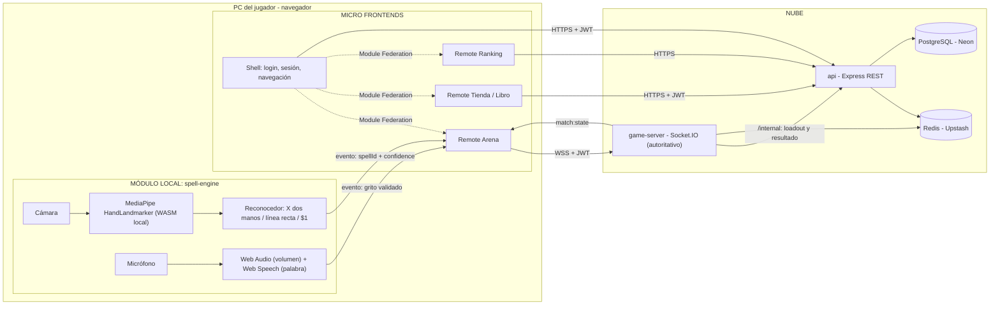

# CLAUDE.md — Duelo de hechiceros

Contexto completo del proyecto. Claude Code lee este archivo automáticamente desde la raíz del repositorio. **Es la fuente de verdad del diseño:** si una instrucción en el chat lo contradice, señálalo antes de actuar.

---

## 1. Qué es el proyecto

Juego web para dos jugadores. Cada jugador está frente a su cámara y lanza hechizos dibujando gestos con la mano (detectados con MediaPipe en su propio PC). Para lanzar un hechizo definitivo, grita su nombre al micrófono. Los dos jugadores se enfrentan en tiempo real por WebSocket.

- **Curso:** Arquitectura de Software, Ingeniería de Sistemas, sexto semestre.
- **Entrega:** 17 de noviembre de 2026.
- **Presupuesto de nube:** solo capas gratuitas.

### Requisitos obligatorios (evaluados por el profesor)

Ninguna decisión puede dejar uno sin cumplir. Si un cambio pone en riesgo alguno, adviértelo antes de continuar.

| Req. | Requisito | Qué lo cumple | Cómo se demuestra |
|---|---|---|---|
| R1 | Desplegado en la nube | Vercel (4 frontends), Render (2 servicios), Neon, Upstash | URLs públicas en vivo |
| R2 | Módulo local | `packages/spell-engine`: MediaPipe + reconocedor en el PC del jugador | DevTools → Network: solo viajan eventos pequeños; sin internet la detección sigue |
| R3 | Sockets | `services/game-server` con Socket.IO | Dos PCs: un gesto en uno baja la vida en el otro |
| R4 | Cámara y micrófono | Gestos (cámara) y grito del definitivo (micrófono) | Partida en vivo |
| R5 | Mínimo 2 bases de datos | PostgreSQL (permanente) + Redis (en vivo) | Tablas en Neon; claves en Upstash durante una partida |
| R6 | 100 % del código en GitHub | Monorepo de la organización | PRs, revisiones, Actions en verde |
| R7 | Micro frontends | Shell + 3 remotes con despliegue independiente | 4 URLs distintas; redesplegar uno sin tocar el resto |

### Restricciones

- **Nunca** enviar video ni audio crudo al servidor: solo eventos ya procesados (`{ spellId, confidence }`).
- Nada de servicios de pago si hay alternativa gratuita suficiente.
- **No inventar versiones de librerías ni APIs.** Si no estás seguro, verifícalo en la documentación oficial o en `npm view <paquete>` antes de escribir código.
- No sobrediseñar: plazo fijo. Si algo añade complejidad sin cumplir un requisito ni mejorar la nota, dilo y propón omitirlo.

---

## 2. Equipo y áreas

Cada integrante es dueño de su área y **sube su propio código**: la participación en GitHub debe quedar equilibrada. No modifiques el área de otro integrante sin que el usuario lo pida; si hace falta, propón el cambio y explica a quién afecta.

| Integrante | Claude Pro | Área | Carpetas |
|---|---|---|---|
| Felipe Espitia | Sí | Plataforma e integración: shell, Module Federation, auth (REST y socket), GitHub Actions, despliegues | `apps/shell`, `services/api` (auth), `.github/`, raíz del repo |
| Juan Arias | Sí | Módulo local + Arena: MediaPipe, reconocedor $1, línea recta, X de dos manos, voz | `packages/spell-engine`, `apps/arena` |
| Johan Soriano | Sí | Tiempo real: matchmaking, partida en memoria, reglas de combate, reconexión, abandono | `services/game-server` |
| Angel Arenales | No | Tienda: catálogo, compra, grimorio, semillas, componentes visuales | `apps/tienda`, `services/api` (tienda), `packages/ui` |
| Daniel Tapiero | No | Ranking: ranking, historial, puntos al cerrar partida, README y guion | `apps/ranking`, `services/api` (ranking) |

`packages/contracts` y `packages/game-rules` son compartidos: cualquier cambio requiere aviso al equipo, porque rompe a todos.

### Calendario

| Sprint | Fechas | Objetivo |
|---|---|---|
| S0 Preparación | 30 oct – 3 nov | Cuentas, repo, spikes de MediaPipe y Module Federation |
| S1 Esqueleto | 4 – 6 nov | Monorepo, contratos, auth, bases de datos conectadas |
| S2 Camino mínimo jugable | 7 – 10 nov | Dos jugadores, Rayo y Escudo, daño, fin de partida |
| S3 Completar | 11 – 14 nov | Tienda, grimorio, ranking, voz, resto de hechizos |
| S4 Cierre | 15 – 16 nov | Errores, pruebas con dos PCs, ensayo. **Sin cambios de infraestructura** |
| Entrega | 17 nov | |

### Prioridades (qué recortar si no alcanza el tiempo)

| Prioridad | Contenido |
|---|---|
| **P0** (no se recorta) | Login, matchmaking, Rayo, Escudo, daño, fin de partida, abandono del rival, despliegue |
| **P1** | Tienda y grimorio, ranking, Meteoro por voz, Corte, Bola de fuego, Curación, Veneno, Congelar |
| **P2** | Sello de silencio, Tormenta, Renacer, Vacío púrpura (si no alcanza: "próximamente" en el catálogo) |

Siempre termina P0 de punta a punta antes de empezar P1.

---

## 3. Stack

| Pieza | Tecnología |
|---|---|
| Frontend | React + Vite + TypeScript |
| Micro frontends | Module Federation: `@module-federation/vite` (plan B: `@originjs/vite-plugin-federation`) |
| Gráficos de la arena | Canvas 2D o CSS. Sin motores de juego |
| Gestos | MediaPipe Tasks Vision (`HandLandmarker`) + reconocedor **$1 Unistroke** propio |
| Voz | Web Audio API (volumen del grito) + Web Speech API (validar la palabra) |
| Backend | Node.js + Express (`api`) y Node.js + Socket.IO (`game-server`) |
| ORM | Prisma |
| Auth | JWT propio (bcrypt + jsonwebtoken), el mismo token para REST y socket |
| Monorepo | pnpm workspaces (sin Turborepo ni Nx) |
| CI/CD | GitHub Actions |

Verifica en la documentación oficial las versiones actuales antes de instalar.

---

## 4. Arquitectura



### Principios

- **Servidor autoritativo:** el cliente solo dice "lancé X". El `game-server` valida (inventario, maná, cooldown, silencio, partida activa) y decide el resultado. El cliente nunca calcula daño.
- **Estado de la partida en memoria del `game-server`** (tick de 100 ms). Redis solo guarda instantáneas en momentos clave (inicio, cada hechizo, fin), la cola de matchmaking y el ranking. Escribir cada tick en Redis agotaría los 500 000 comandos/mes de Upstash.
- **Una sola instancia del `game-server`:** el emparejamiento corre en un ciclo dentro del proceso (cada 1 s). Sin bloqueos distribuidos ni Lua.
- **Los números de balance viven en `packages/game-rules`**, no en la base de datos. PostgreSQL solo guarda lo comercial y lo histórico.
- **Ninguna URL se escribe en el código:** todas salen de variables de entorno.

---

## 5. Estructura del repositorio

```text
duelo-de-hechiceros/
├── apps/                       # Micro frontends (un proyecto de Vercel por carpeta)
│   ├── shell/                  # Felipe
│   ├── arena/                  # Juan
│   ├── tienda/                 # Angel
│   └── ranking/                # Daniel
├── services/                   # Backends (un servicio de Render por carpeta)
│   ├── api/                    # Felipe (auth) + Angel (tienda) + Daniel (ranking)
│   │   └── prisma/schema.prisma
│   └── game-server/            # Johan
├── packages/                   # Compartido; no se despliega solo
│   ├── contracts/              # Tipos de eventos del socket, REST y CustomEvents
│   ├── game-rules/             # Catálogo, balance, rangos, economía
│   ├── spell-engine/           # Módulo local (Juan)
│   └── ui/                     # Componentes visuales (Angel)
├── docs/                       # Hoja de hechizos, zona DNS exportada, guion
├── .github/                    # workflows/, CODEOWNERS, plantilla de PR
├── docker-compose.yml          # Postgres + Redis locales
├── pnpm-workspace.yaml
└── package.json
```

Nombres de paquete con alcance `@duelo/` (por ejemplo, `@duelo/contracts`). Comandos típicos: `pnpm --filter arena dev`, `pnpm --filter api test`.

---

## 6. Diseño del juego

### Reglas generales

| Regla | Valor |
|---|---|
| Formato | 1 contra 1, tiempo real, una ronda |
| Duración máxima | 90 s |
| Vida | 100 |
| Maná | Máximo 100; inicia en 30; +4 por segundo |
| Inicio | Calibración de cámara → cuenta regresiva 3-2-1 |
| Victoria | Vida del rival en 0. Al acabar el tiempo gana quien tenga más vida; igualdad = empate |
| Confianza mínima del reconocedor | 0,80. Por debajo: "¡Hechizo fallido!", no gasta maná, penalización de 0,5 s |
| Intervalo mínimo entre hechizos | 300 ms (anti-trampas) |
| Abandono | 10 s de espera para reconectar; si no vuelve, pierde |

### Cómo se lanza un hechizo

1. **Pinza** (pulgar e índice juntos) = empezar a dibujar. Se sigue la punta del índice y se dibuja una estela.
2. Separar los dedos = terminar el trazo y clasificarlo.
3. **Orden de detección:**
   1. ¿Dos manos visibles? → comprobar la **X** del Sello (mientras haya dos manos, el dibujo con pinza se pausa).
   2. ¿Trazo recto? → **Corte**. Rectitud: distancia inicio–fin ≥ 90 % de la longitud total, y longitud ≥ 1/4 del ancho de la cámara. La línea **no** pasa por el $1 (el $1 normaliza escala y deforma las líneas).
   3. Si no → reconocedor **$1** contra las plantillas de los hechizos del grimorio del jugador.
4. **X del Sello:** dos manos; los segmentos base→punta de ambos índices se intersectan; ángulo entre 45° y 135°; sostenida 0,7 s continuos. Al detectarla, círculo de carga y evento `combat:seal-charging`; si se separan las manos antes, `combat:seal-cancel` sin gastar maná.

### Hechizos

| id | Nombre | Gesto | Efecto | Maná | Cooldown | Precio |
|---|---|---|---|---|---|---|
| `lightning` | ⚡ Rayo | Zigzag (izquierda → derecha) | 10 de daño | 10 | 1,5 s | Inicial |
| `shield` | 🛡️ Escudo | Círculo | Absorbe por completo el siguiente ataque recibido en los próximos 3 s | 20 | 6 s | Inicial |
| `slash` | 🗡️ Corte | Línea recta, cualquier dirección | 5 de daño | 6 | 0,8 s | 50 oro |
| `fireball` | 🔥 Bola de fuego | Triángulo | 15 de daño + quemadura de 2/s durante 3 s | 25 | 4 s | 100 oro |
| `heal` | 💚 Curación | V | +15 de vida (máx. 100); no quita quemadura ni veneno | 30 | 10 s | 150 oro |
| `poison` | 🐍 Veneno | S (arriba → abajo); plan B: espiral | 2 de daño y −3 de maná por segundo durante 6 s | 25 | 8 s | 200 oro |
| `freeze` | ❄️ Congelar | Cuadrado | Los cooldowns del rival duran el doble durante 5 s | 35 | 12 s | 250 oro |
| `silence-seal` | ✖️ Sello de silencio | X con los dos índices, sostenida 0,7 s | El rival no puede lanzar nada (ni definitivos) durante 7 s; mientras dure, el rival recupera maná a 8/s | 70 | 1 vez por partida | 400 oro |

### Definitivos

Todos cuestan **100 de maná** (maná lleno) y se activan gritando su nombre. Para aceptarlos se exigen dos cosas: volumen sobre el umbral del grito **y** que Web Speech reconozca la palabra. Normalizar el texto (minúsculas, sin tildes) antes de comparar.

| id | Nombre | Palabras aceptadas | Requisito | Efecto | Uso | Precio |
|---|---|---|---|---|---|---|
| `meteor` | ☄️ Meteoro | `meteoro` | — | 35 de daño; el escudo lo reduce a la mitad (17) y desaparece | Libre | Inicial |
| `storm` | 🌪️ Tormenta | `tormenta` | — | 8 de daño/s durante 5 s (40); no se bloquea | Libre | 300 oro |
| `rebirth` | ✨ Renacer | `renacer` | — | +40 de vida; elimina quemadura, veneno y efectos negativos | Libre | 300 oro |
| `purple-void` | 🟣 Vacío púrpura | `vacio` o `purpura` | Vida ≤ 30 | 50 de daño; el escudo lo reduce a la mitad (25) | 1 vez por partida | 500 oro |

### Interacciones

| Situación | Resultado |
|---|---|
| Rayo, Corte, Fuego, Veneno, Congelar o Sello contra Escudo activo | El escudo lo absorbe por completo y desaparece (sin quemadura, sin veneno, sin sello) |
| Meteoro o Vacío púrpura contra Escudo | Daño a la mitad (redondeado hacia abajo) y el escudo desaparece |
| Tormenta contra Escudo | No se bloquea |
| Lanzar estando sellado | Rechazado: `SILENCED` |
| Sellar a un rival ya sellado | Rechazado |
| Curación con quemadura o veneno | Cura la vida; el efecto sigue |
| Fuego + Veneno | Se acumulan |
| Veneno con el rival en 0 de maná | Sigue haciendo daño; el maná no baja de 0 |
| Vacío púrpura con vida > 30 | Rechazado: `REQUIREMENT_NOT_MET`; no gasta maná |
| Curarse por encima de 30 | El Vacío púrpura vuelve a bloquearse |
| Dos hechizos simultáneos | Se procesan en el orden de llegada |

### Grimorio

- 4 espacios de hechizos: **Rayo y Escudo siempre fijos** en los espacios 1 y 2; los otros dos, hechizos comprados.
- 1 espacio aparte para el definitivo (Meteoro por defecto).
- El reconocedor $1 solo compara contra las plantillas del grimorio (menos confusiones).
- El grimorio se arma en la Tienda y el servidor lo consulta al `api`: **nunca** viaja desde el cliente.

### Economía

| Resultado | Puntos de rango | Oro arcano |
|---|---|---|
| Victoria | +25 | +50 |
| Derrota | −15 (nunca bajo 0) | +20 |
| Empate | 0 | +30 |
| Abandono (quien abandona) | −25 | 0 |
| Abandono (quien se queda) | +25 | +50 |

Puntos de rango y oro son valores separados: comprar nunca baja el ranking. Al registrarse, el usuario recibe Rayo, Escudo y Meteoro, con 0 de oro. Para la demo, preparar cuentas con oro.

### Rangos

| Rango | Puntos |
|---|---|
| Grado 4 | 0 – 99 |
| Grado 3 | 100 – 249 |
| Grado 2 | 250 – 499 |
| Grado 1 | 500 – 899 |
| Grado Especial | 900 o más |

El rango **no se guarda** en la base: se calcula desde `rating` con la tabla de `game-rules`.

### Matchmaking

1. Cola en Redis ordenada por rating.
2. Primero, rival a ≤ 150 puntos de diferencia.
3. Cada 10 s sin rival, el margen crece 100 puntos.
4. Tras 30 s, cualquier rival disponible.

---

## 7. Contrato del socket

- Conexión con `auth: { token: "<JWT>" }`; middleware que rechaza con `UNAUTHORIZED`.
- Todo evento cliente → servidor usa *ack* de Socket.IO: `{ ok: true }` o `{ ok: false, code }`.
- Nombres de eventos `dominio:accion`. IDs de hechizos en inglés y `kebab-case`.
- Tiempos absolutos (`until`, `endsAt`) en milisegundos epoch, siempre junto a `serverNow`; el cliente calcula su desfase de reloj.
- Los tipos viven en `packages/contracts`.

### Cliente → servidor

| Evento | Payload |
|---|---|
| `matchmaking:join` | `{}` |
| `matchmaking:leave` | `{}` |
| `match:ready` | `{ matchId }` |
| `match:rejoin` | `{ matchId }` |
| `combat:cast-spell` | `{ matchId, castId, spellId, confidence }` |
| `combat:cast-ultimate` | `{ matchId, castId, ultimateId, transcript }` |
| `combat:seal-charging` | `{ matchId }` |
| `combat:seal-cancel` | `{ matchId }` |

### Servidor → cliente

| Evento | Payload |
|---|---|
| `matchmaking:queued` | `{ ratingRange }` |
| `match:found` | `{ matchId, you, rival }` |
| `match:start` | `{ matchId, startsAt, endsAt, serverNow }` |
| `match:state` | Estado completo; 5 veces por segundo y tras cada hechizo |
| `combat:spell-resolved` | `{ castId, casterId, spellId, outcome, damage }` |
| `combat:spell-rejected` | `{ castId, code }` |
| `combat:seal-warning` | `{ byPlayerId }` |
| `match:opponent-disconnected` | `{ graceMs }` |
| `match:opponent-reconnected` | `{}` |
| `match:end` | `{ winnerId, reason, rewards }` |

**Códigos de rechazo:** `NO_MANA`, `COOLDOWN`, `SILENCED`, `NOT_IN_GRIMOIRE`, `RATE_LIMIT`, `LOW_CONFIDENCE`, `REQUIREMENT_NOT_MET`, `ALREADY_USED`, `MATCH_NOT_ACTIVE`, `SEAL_NOT_CHARGED`.
**Motivos de fin:** `KO`, `TIMEOUT`, `DRAW`, `ABANDON`.
**Regla del Sello:** el servidor solo acepta `silence-seal` si recibió `combat:seal-charging` de ese jugador al menos 0,6 s antes.

### Ejemplos

```json
// combat:cast-spell (cliente → servidor)
{ "matchId": "m_8f2c41", "castId": "c_0007", "spellId": "lightning", "confidence": 0.91 }
```

```json
// match:state (servidor → cliente)
{
  "matchId": "m_8f2c41",
  "status": "active",
  "serverNow": 1793370012345,
  "endsAt": 1793370090000,
  "players": {
    "u_felipe": {
      "hp": 82, "mana": 46, "shieldUntil": null,
      "effects": [{ "type": "poison", "until": 1793370016000 }],
      "cooldownsUntil": { "lightning": 1793370013500 },
      "silencedUntil": null,
      "used": { "silence-seal": false, "purple-void": false }
    },
    "u_johan": {
      "hp": 64, "mana": 71, "shieldUntil": 1793370014000,
      "effects": [], "cooldownsUntil": {}, "silencedUntil": null,
      "used": { "silence-seal": true, "purple-void": false }
    }
  }
}
```

```json
// match:end (servidor → cliente)
{
  "matchId": "m_8f2c41", "winnerId": "u_felipe", "reason": "KO",
  "rewards": {
    "u_felipe": { "ratingDelta": 25, "goldDelta": 50, "newRating": 125, "newRank": "Grado 3" },
    "u_johan":  { "ratingDelta": -15, "goldDelta": 20, "newRating": 85, "newRank": "Grado 4" }
  }
}
```

---

## 8. Datos

### PostgreSQL (Prisma, Neon)

| Tabla | Columnas | Notas |
|---|---|---|
| `users` | `id` uuid PK, `username` único, `email` único, `password_hash`, `rating` int def. 0, `gold` int def. 0, `wins`, `losses`, `draws`, `equipped_ultimate_id` FK → spells, `created_at` | `rating` y `gold` nunca negativos |
| `spells` | `id` text PK (`lightning`…), `name`, `kind` (`spell` \| `ultimate`), `gesture_description`, `price`, `is_starter`, `sort_order` | Se llena con un *seed* desde `game-rules` |
| `user_spells` | PK (`user_id`, `spell_id`), `price_paid`, `acquired_at` | Inventario |
| `grimoire_slots` | PK (`user_id`, `slot` 1–4), `spell_id` | Slots 1 y 2 = Rayo y Escudo |
| `matches` | `id` uuid PK, `end_reason`, `winner_id` (null si empate), `duration_ms`, `started_at`, `ended_at` | |
| `match_players` | PK (`match_id`, `user_id`), `rating_before`, `rating_delta`, `gold_delta`, `final_hp` | |

- **Compra atómica:** descontar oro y registrar el hechizo en una sola transacción, con condición `gold >= precio`. Dos clics no compran dos veces ni dejan oro negativo.
- **Registro:** dar Rayo, Escudo y Meteoro; grimorio inicial Rayo (slot 1) y Escudo (slot 2).

### Redis (Upstash), prefijo `dh:`

| Clave | Tipo | Contenido | TTL | Escribe |
|---|---|---|---|---|
| `dh:mm:queue` | Sorted set | `userId` → rating | Sin TTL | game-server |
| `dh:mm:ticket:{userId}` | Hash | Hora de ingreso, grimorio validado | 120 s | game-server |
| `dh:match:{matchId}` | Hash | Instantánea de la partida | 300 s | game-server |
| `dh:user:{userId}:match` | String | `matchId` activo (reconexión y bloqueo de doble cola) | 300 s | game-server |
| `dh:ranking` | Sorted set | `userId` → rating | Sin TTL | api |

PostgreSQL es la fuente de verdad del ranking: si `dh:ranking` se pierde, el `api` lo reconstruye desde `users` al arrancar.

### Endpoints REST del `api`

| Método y ruta | Uso | Dueño |
|---|---|---|
| `POST /auth/register`, `POST /auth/login` | Cuentas | Felipe |
| `GET /me` | Perfil, oro, rating, rango | Felipe |
| `GET /spells` | Catálogo | Angel |
| `GET /me/inventory` | Hechizos del jugador | Angel |
| `POST /shop/purchase` | Comprar | Angel |
| `PUT /me/grimoire` | Guardar grimorio | Angel |
| `GET /ranking`, `GET /ranking/me` | Top y posición propia | Daniel |
| `GET /me/matches` | Historial | Daniel |
| `GET /internal/users/:id/loadout` | El game-server consulta el grimorio | Angel |
| `POST /internal/matches` | El game-server registra el resultado | Daniel |

`/internal/*` exige la cabecera `x-internal-key` con `INTERNAL_API_KEY`.

---

## 9. Comunicación entre micro frontends

- **Shell → remotes:** propiedades del componente `App` de cada remote: `session` (`{ token, user: { id, username } }`) y `navigate`.
- **Remotes → shell u otros remotes:** `CustomEvent` del navegador con prefijo `duelo:`.
- **Nada de estado global compartido** (ni Redux ni stores federados).
- Cada remote lee las URLs del `api` y del `game-server` de sus propias variables de entorno.

| Evento | Emite | Escucha | Payload |
|---|---|---|---|
| `duelo:gold-changed` | Tienda, Arena | Shell | `{ gold }` |
| `duelo:match-ended` | Arena | Shell, Ranking | `{ matchId, newRating }` |
| `duelo:session-expired` | Cualquiera (ante un 401) | Shell (lleva al login) | `{}` |

| Dependencia | ¿Compartida en Module Federation? |
|---|---|
| `react`, `react-dom` | Sí, **singleton** (dos copias rompen los hooks) |
| `react-router-dom` | No: solo el shell enruta |
| `@duelo/contracts`, `@duelo/game-rules`, `@duelo/ui` | No: se empaquetan en cada app |
| MediaPipe | No: solo la Arena |

Cada remote debe poder correr solo con una sesión de prueba (`pnpm --filter tienda dev`), sin levantar el shell.

---

## 10. Despliegue

| Parte | Plataforma | URL por defecto (plan B permanente) | Subdominio propio |
|---|---|---|---|
| Shell | Vercel (Hobby) | `*.vercel.app` | `duelohechiceros.qd.je` |
| Arena | Vercel | `*.vercel.app` | `arena.duelohechiceros.qd.je` |
| Tienda | Vercel | `*.vercel.app` | `tienda.duelohechiceros.qd.je` |
| Ranking | Vercel | `*.vercel.app` | `ranking.duelohechiceros.qd.je` |
| api | Render (free) | `*.onrender.com` | `api.duelohechiceros.qd.je` |
| game-server | Render (free) | `*.onrender.com` | `game.duelohechiceros.qd.je` |
| PostgreSQL | Neon (free) | | |
| Redis | Upstash (free: 500 000 comandos/mes, 256 MB) | | |

- Cada proyecto de Vercel y servicio de Render apunta a su carpeta del monorepo.
- **Dominio:** `duelohechiceros.qd.je` registrado en DigitalPlat (vence el 5 nov 2027). **Pendiente:** el profesor pidió delegarlo a `ns1.magicsolutions.co` y `ns2.magicsolutions.co`; tras el cambio, los registros DNS se crean en ese panel, no en DigitalPlat.
- **Render free:** se duerme tras 15 min sin tráfico (≈1 min en despertar); los mensajes WebSocket lo mantienen despierto. Despertar los servicios antes de la sustentación. No usar pings automáticos (consumen las 750 h/mes).
- **Neon free:** se suspende tras 5 min sin uso; la primera consulta tarda un poco más.
- HTTPS obligatorio (la cámara no abre sin él) y socket con `wss://`.
- CORS: orígenes permitidos por variable de entorno en `api` y `game-server`.
- Sin cambios de infraestructura después del 14 de noviembre.

### Variables de entorno (nombres; los valores están en Bitwarden, nunca en el repo)

| Variable | Dónde |
|---|---|
| `DATABASE_URL` | api |
| `REDIS_URL` | api, game-server |
| `JWT_SECRET` | api, game-server |
| `INTERNAL_API_KEY` | api, game-server |
| `API_INTERNAL_URL` | game-server |
| `ALLOWED_ORIGINS` | api, game-server |
| `VITE_API_URL`, `VITE_GAME_SERVER_URL` | shell, arena, tienda, ranking (según usen) |
| `VITE_REMOTE_ARENA_URL`, `VITE_REMOTE_TIENDA_URL`, `VITE_REMOTE_RANKING_URL` | shell |

Cada app y servicio tiene un `.env.example` con los nombres y sin valores.

---

## 11. Convenciones

- **TypeScript** en todo el repo.
- Identificadores en **inglés**; **comentarios en español** que expliquen el porqué, no lo obvio.
- `camelCase` para variables y funciones, `PascalCase` para componentes y tipos, `kebab-case` para archivos y carpetas.
- Eventos de socket `dominio:accion`; CustomEvents `duelo:accion`.
- Commits con *Conventional Commits*: `feat(arena): reconocer zigzag`, `fix(game-server): cooldown del escudo`.
- Ramas: `feat/arena-gestos`, `fix/socket-reconexion`.
- `main` protegida: todo entra por PR con 1 aprobación de otro integrante y CI en verde.
- Commits pequeños y frecuentes; nada de un commit gigante al final.

### Manejo de errores obligatorio

- Cámara o micrófono denegados: mensaje claro con instrucciones para habilitarlos; el micrófono denegado solo desactiva los definitivos, no el juego.
- Desconexión del socket: reconexión automática y `match:rejoin`; aviso visible al jugador.
- Rival que abandona: mostrar la espera de 10 s y luego la victoria por abandono.
- Respuesta 401 del `api`: emitir `duelo:session-expired`.
- MediaPipe que no carga: mensaje de error, no pantalla en blanco.

---

## 12. Cómo debe trabajar Claude Code en este repo

1. Antes de escribir código, lee los archivos existentes del área y los contratos en `packages/contracts`.
2. Entrega **archivos completos y funcionales**, con su ruta.
3. Respeta los contratos de esta guía. Si algo necesita cambiarlos, detente y propónlo explicando a quién afecta.
4. No inventes versiones ni APIs: consulta `npm view` o la documentación oficial.
5. Prueba lo que construyes (tests, `pnpm build`, ejecución local) antes de darlo por terminado.
6. Prioriza P0 sobre P1 y P1 sobre P2.
7. No hagas commit ni push sin que el usuario lo pida. El usuario sube su propio código para que su participación quede registrada.
8. Nunca escribas secretos en archivos versionados.
9. Si una petición rompe un requisito R1–R7 o el calendario, adviértelo antes de continuar.
